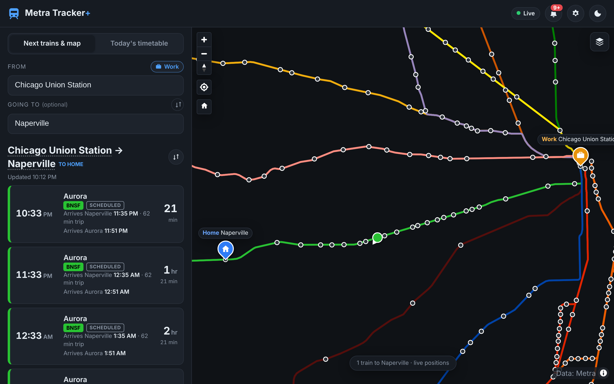
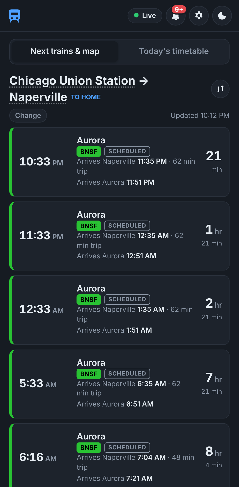

# Metra Tracker+

Better Metra tracker for phone and data usage.

A self-hosted web app that shows live Metra trains. It runs in Docker on a home server (an Unraid template is included) and you open it in a browser on any phone, tablet or computer on your network: `http://<your-server-ip>:8080`.

| Desktop | Phone |
|---|---|
|  |  |

*Screenshots use the "Simple" map background. With the self-hosted map downloaded, a street map sits under the lines.*

## What it does

- **When is my next train, and is it on time?** Pick a station. With no destination, the board shows a card per line and direction: the next train big, the following ones as small times; tap one to see every train on that line. Pick where you're going for arrival times. The board shows the next trains with how long until each leaves, and whether it's on time, late or cancelled. A late train shows the original time crossed out, the new time beside it, and the reason if Metra has posted one.
- **What's left today?** The **Today's timetable** tab lists every train still to come from your station, grouped by hour, with live times where Metra has them.
- **Where are the trains?** A map shows every line in its official color and the trains moving along it. Tap a train on the board to see it on the map, or tap one on the map to find it on the board. The **Map** tab shows just the map, full screen on a phone, and **Clear** goes back to showing every train.
- **Is anything wrong on my line?** Service alerts sit behind a 🔔 bell with a badge for new ones. Alerts that mean trains won't match the timetable (extra service, line closures, trains running express) are tagged **Schedule change** and shown above the board.
- **Home and work.** Set a home and work station once. On workdays the app opens on the trip to work in the morning and the trip home after your switch time. It's saved on the server, so every device opens the same way.
- **Can my phone just tell me?** Home Assistant can ask the app for your commute and send a weekday-morning notification like *"7:12 AM (on time), 7:30 AM (8 min late: Weather)"*.
- **How reliable is my train?** The app keeps a year of delay and cancellation history and shows each train's on-time record at your station.

It's light on your phone's data: the server talks to Metra, and your phone only downloads small summaries from the server. It works before you have a Metra API key, using the published schedule and estimated train positions. Add the key and everything switches to live data.

## Features

### Departure board
- **Next trains** (3, 5, 8, 10 or any number up to 50; set in ⚙ Settings) with time, how long until it leaves (minutes, or hours and minutes past an hour), destination, line, train number and a badge:
  - **Live**: Metra's own prediction.
  - **Tracking**: Metra reports the train's GPS position but sent no prediction, so the delay is estimated from where the train is compared with the timetable ("~3 min late").
  - **Scheduled**: no live data; timetable time.
- Delays of 1–5 min are amber and 6+ min red (Metra counts under 6 minutes as on time). Departures are never shown earlier than scheduled. Cancelled trains are struck through. Extra trains not in the timetable are tagged **Extra train**.
- With a **Going to** station, each train shows its arrival time there and the trip length. Every train also shows its estimated arrival at the end of the line.
- **Delay reasons** come from an alert naming that train, or else one for its line. The alert's cause is shown (e.g. "Weather"), or its text if the cause is unknown.
- **On-time history**: once a train has been seen on 5+ days, it shows its record at your station over the last 30 days, e.g. "90% on time · avg 3 min late". Weekday, Saturday and Sunday trains are counted separately.
- **Station pickers**: search by station or line (e.g. "upn"). The **Going to** list only suggests stations you can reach on a direct train from your **From** station, grouped *Toward downtown* / *Away from downtown*, in line order, with ride times. Typing still finds any station.
- The ⇅ button next to the board title flips the direction. Tap a station name in the title to show it on the map.

### Map
- Every Metra line in its official color, station dots, and trains that refresh every 30 s. Tap a train for its number, destination, next stop and delay.
- With a **Going to** station set, the map only shows trains running from your station toward it that haven't reached it yet (Settings → *Trains on the map* → *All trains* shows everything).
- **Map settings** (layers button): background, opacity, a railway-tracks overlay, **3D buildings** (from street level in), line opacity and width, and on/off switches for lines, stations and trains. Saved per device.
- Home and work appear as labelled pins; the map opens framed on your commute.

### Alerts
- **Bell** (default), **Banner** or **Off**, for **all lines** or **my lines** (lines through your home, work and selected stations). Set in ⚙ Settings.
- Stale and out-of-service trains are hidden: positions that stop updating for 3+ minutes, and trains still tagged with a trip that has ended.
- The status pill checks the age of Metra's data itself, so it shows "Live · 4 min old" when Metra falls behind, and falls back to the schedule if the feed fails.

### Settings page (⚙)
- **Your commute** (shared by all devices): home, work, the time it switches to trains home, workdays.
- **Appearance** and **Display** (this device only): theme, number of trains, trains on the map, hide the From/Going-to boxes, alerts bell/banner/off.
- **About**: realtime status, schedule version, map status.

### Other
- Works on phones, dark and light modes, installable as a web app.
- **History** in SQLite (`/config/history.db`): every realtime prediction, cancellation and alert, kept for `HISTORY_DAYS` (default 365), with on-time stats and CSV export.
- **Schedule-only mode**: without `METRA_API_TOKEN`, everything runs from the published schedule and train positions are estimated along the tracks.

### Data and licensing
- The schedule (static GTFS) comes from `https://schedules.metrarail.com/gtfs/schedule.zip`. The app checks `published.txt` every hour and reloads when it changes, and re-downloads the whole file once a week in case it changed silently. A download is only used if it reads correctly and has trains in the coming week; the previous schedule is kept as a backup.
- Live data (GTFS-Realtime: `positions`, `tripupdates`, `alerts`) comes from `https://gtfspublic.metrarr.com/gtfs/public/…` with `Authorization: Bearer $METRA_API_TOKEN`. It is polled every 30 s and never faster.
- **The browser never contacts Metra.** All Metra requests are made by the server, as Metra's license requires.
- Trip, service, shape and stop IDs are treated as opaque strings. If realtime trip IDs stop matching the schedule, trips are matched by route + start time + service day instead.

## Install on Unraid

GitHub builds and publishes a ready-to-run image (`ghcr.io/heyimdownhere/metra-tracker-plus:latest`) on every push to `main`, and the Unraid template uses it. Nothing needs building.

1. **Add the template.** Open a terminal on Unraid (**>_** icon at top right of the web UI) and run:
   ```sh
   wget -O /boot/config/plugins/dockerMan/templates-user/my-metra-tracker-plus.xml \
     https://raw.githubusercontent.com/heyimdownhere/metra-tracker-plus/main/unraid/metra-tracker-plus.xml
   ```
2. **Create the container.** **Docker → Add Container**, then choose **metra-tracker-plus** in the **Template** dropdown (under *User templates*).
3. **Fill in the fields:**
   - **Metra API key**: your key (the field is masked). Leave it empty to run schedule-only.
   - **Home station / Work station / Commute switch time / Workdays**: optional; you can set these in the app instead (⚙ Settings → Edit commute). Stations can be an id (`NAPERVILLE`, `CUS`) or a name.
   - **Web UI port**: 8080, unless that's taken on your server.
   - **Appdata**: `/mnt/user/appdata/metra-tracker` (default).
   - More options are under **Show more settings**.
4. Click **Apply**. Unraid pulls the image and starts the container.
5. Open `http://<your-server-ip>:8080`, or click the container icon → **WebUI**. On first start it downloads Metra's schedule, which takes a few seconds.
6. **Check:** the status pill shows **Live**, and the container's **Logs** start with a settings summary. Fix anything the log warns about.

**Changing settings later:** Docker tab → container icon → **Edit**, change a field, **Apply**. The schedule cache, history and app settings in appdata are kept.

**Updating:** Docker tab → **Check for Updates**, then **Apply update**.

**Using it away from home:** put the server on a private network such as Tailscale or WireGuard. Don't port-forward the app to the internet: it has no login.

### docker compose

```sh
cp .env.example .env    # then edit .env: API key, stations, port...
docker compose up -d
```

### Build the image yourself

```sh
git clone https://github.com/heyimdownhere/metra-tracker-plus.git
docker build -t metra-tracker-plus:latest metra-tracker-plus
```

Then use `metra-tracker-plus:latest` as the image (Unraid: the template's **Repository** field; compose: `IMAGE=metra-tracker-plus:latest`).

### Backing up

`/config/history.db` holds the delay history (about 1 GB a year at the default 365 days). Unraid's **Appdata Backup** plugin backs up the appdata folder with your other containers. `/config/gtfs/` and `/config/map/` are caches and don't need backing up.

## The map

The map is **self-hosted**. On first start, the server downloads a Chicago-area extract of the OpenStreetMap map from [Protomaps](https://protomaps.com) into `/config/map/` (one file, a few hundred MB at the default detail), plus label fonts and icons, and refreshes it about monthly. The server then serves map tiles itself, so phones never load map data from outside servers. Like any tiled map, zoomed out it loads a few low-detail tiles; zooming in loads sharper tiles only for the area on screen.

Backgrounds (layers button):
- **Map (matches theme)** (default), **Map: light**, **Map: dark**: the self-hosted map.
- **Streets (online, OpenFreeMap)** and **Satellite (online, Esri)**: optional online maps.
- **Simple**: no map, just the Metra lines.

While the map is still downloading, or if the download failed, the map options fall back to the matching free online map (OpenFreeMap), and to **Simple** if that can't load either.

## Phone data use

- Responses are gzip-compressed. Scripts are cached by the phone and only downloaded again after an update (the map library is about 276 KB once).
- The train list is about 3 KB every 30 s. The app stops refreshing when it's in the background or the phone is locked.
- The **Today's timetable** tab doesn't load the map or train positions at all.
- Map tiles are cached and only cover what's on screen. 3D buildings add the most; turn them off in the map settings if data matters.

## Configuration

Everything is optional; with nothing set the app runs schedule-only and asks for your stations on first use. Set values as environment variables: Unraid template fields, `.env` for docker compose (copy `.env.example`), or `-e` with `docker run`. The container log starts with a summary of the settings it picked up (API key masked) and warns about any value it couldn't use.

| Variable | Default | Purpose |
|---|---|---|
| `METRA_API_TOKEN` | *(empty)* | Metra GTFS-RT API key. Empty = schedule-only. |
| `METRA_API_TOKEN_FILE` | *(empty)* | Read the key from a file instead (Docker/compose secrets). The variable wins if both are set. |
| `HOME_STATION` | *(empty)* | Default home station: an id (`NAPERVILLE`) or a name. Ids are at `/api/stations`. |
| `HOME_DESTINATION` | *(empty)* | Default "Going to" for the home board (when no work station is set). |
| `WORK_STATION` | *(empty)* | Work station. On workdays the app opens on home → work before the switch time, work → home after. Can't be the same as home. |
| `COMMUTE_SWITCH_TIME` | `12:00` | When to switch from trains to work to trains home (24-hour `HH:MM`). |
| `WORK_DAYS` | `mon-fri` | Commute days, e.g. `mon-fri`, `mon,tue,thu`. Other days open on the home board. |
| `TZ` | `America/Chicago` | Container time zone (logs). The app always uses Metra's Chicago time. |
| `HISTORY_DAYS` | `365` | Days of delay history to keep (0–3650). `0` disables history. |
| `REALTIME_INTERVAL` | `30` | Seconds between realtime polls (30–3600). Metra's minimum is 30. |
| `STATIC_CHECK_INTERVAL` | `3600` | Seconds between checks for a new schedule (60–86400). Doesn't affect the 30-second train updates. |
| `STATIC_FULL_REFRESH_DAYS` | `7` | Re-download the whole schedule this often even if Metra says it hasn't changed (0 turns it off). |
| `PORT` | `8080` | Port the app listens on **inside** the container. To change the port you open in the browser, change the host side of the port mapping instead (Unraid "Web UI port", compose `WEB_PORT`). |
| `HOST` | `0.0.0.0` | Address the app listens on inside the container. |
| `MAP_DOWNLOAD` | `true` | Download the self-hosted map (see "The map"). `false` skips it. |
| `MAP_MAX_ZOOM` | `15` | Most detailed map level to download (8–15). `14` is roughly a quarter of the size. |
| `MAP_REFRESH_DAYS` | `30` | Re-download the map after this many days (`0` = never). |
| `MAP_SOURCE` | *(latest Protomaps build)* | Advanced: extract from this `.pmtiles` URL instead. |
| `MAP_BBOX` | Metra area | Advanced: `min_lon,min_lat,max_lon,max_lat` to download. |
| `LOG_LEVEL` | `INFO` | `DEBUG`, `INFO`, `WARNING` or `ERROR`. |
| `CONFIG_DIR` | `/config` | Where the schedule cache, history, map and settings live (mount your appdata here). |

**Home, work, switch time and workdays can also be set in the app** (⚙ Settings → Edit commute, or "Set as home" / "Set as work" next to the station field). Values saved in the app win over the environment; anything left unset in the app falls back to the environment.

## Home Assistant: morning train notification

`GET /api/now` returns the right board for the time of day (home → work in the morning on workdays, work → home after the switch time), so nothing is hard-coded in Home Assistant. `GET /api/commute?from=<station>&to=<station>&limit=3` gives a specific trip. Both include departure and arrival times, minutes until, status (`on time`, `5 min late`, `about 3 min late` for GPS estimates, `cancelled`, `scheduled`), delay reason, and a ready-to-send `message`, for example:

> Naperville → Chicago Union Station: 7:12 AM (on time), 7:30 AM (8 min late: Weather), 7:45 AM (scheduled)

[`docs/home-assistant.yaml`](docs/home-assistant.yaml) has a working setup: a REST sensor, a weekday 6:45 AM push notification with the next three trains, and an optional alert if your train becomes late or cancelled. Change the server address, stations, time and `notify.mobile_app_YOUR_PHONE`.

## API

All endpoints read the server's in-memory copy of Metra's data. **No request to this app ever triggers a request to Metra.** A single background job polls Metra's realtime feeds, and the poll function itself refuses to run more than once every 30 seconds, whatever calls it.

Which way a train is going (`inbound`/`outbound`) is decided by geography: a train is inbound if its last stop is closer to the Loop than your station.

Example: `curl "http://<your-server-ip>:8080/api/next?station=NAPERVILLE&direction=inbound"`

```json
{
  "station": {"id": "NAPERVILLE", "name": "Naperville"},
  "direction": "inbound",
  "next_minutes": 12,
  "message": "Naperville toward downtown: 7:12 AM to Chicago Union Station (on time), ...",
  "trains": [
    {"departure": "2026-11-09T07:12:00-06:00", "minutes_until": 12, "status": "on time",
     "line": "BNSF", "train": "1242", "destination": "Chicago Union Station",
     "final_arrival": "2026-11-09T07:56:00-06:00", "live": true, "...": "..."}
  ]
}
```

| Endpoint | Description |
|---|---|
| `GET /healthz` | Health check. Returns 200 once the schedule is loaded, otherwise 503. |
| `GET /api/status` | Mode, feed health, schedule version, map status, history stats. |
| `GET /api/stations` | Stations with the lines that serve them. |
| `GET /api/next?station=ID&direction=inbound` | **Next trains** at a station. `direction`: `inbound`/`to` = toward downtown, `outbound`/`from` = away, omit for both. `station` takes an id or a name. Optional `limit` (1–20). |
| `GET /api/departures?station=ID&limit=5[&to=ID][&direction=inbound]` | Departure board (`limit` 1–50); with `to`, only trains that later stop there. |
| `GET /api/timetable?station=ID[&to=ID]` | Every train still to come today (until 3 AM, the end of Metra's service day), with live times where available. |
| `GET /api/destinations?station=ID` | Stations reachable on a direct train, in line order, with the shortest ride time and direction. |
| `GET /api/trains[?to=ID[&from=ID]]` | Train positions (live, or estimated from the schedule). With `to`, only trains that will still stop there; with `from` too, only those running from `from` toward `to`. |
| `GET /api/alerts` | Active service alerts (`schedule_change` marks ones that change the timetable). |
| `GET /api/settings` / `PUT /api/settings` | Commute profile shared by all devices: `home_station`, `home_dest`, `work_station`, `switch_time`, `work_days` (Monday = 0), plus `leg` (which trip applies now). |
| `GET /api/now?limit=5` | The board for right now (see Home Assistant above). |
| `GET /api/home?limit=5` / `GET /api/work?limit=5` | Home and work boards. |
| `GET /api/commute?from=ID&to=ID&limit=3` | Commute summary for Home Assistant. |
| `GET /api/lines` | GeoJSON of every line. |
| `GET /api/history/station?station=ID&days=30` | On-time %, average and worst delay, and cancellations per scheduled departure. |
| `GET /api/history/alerts?days=30` | Every alert seen. |
| `GET /api/history/export.csv?days=30` | Raw history as CSV. |
| `GET /api/docs` | Interactive API docs. |

## Development

```sh
pip install -r requirements-dev.txt
CONFIG_DIR=./config uvicorn app.main:app --reload --port 8080
pytest                          # unit tests (synthetic GTFS + GTFS-RT)
METRA_LIVE_TESTS=1 pytest       # also parse Metra's real static feed
```

**Branches and builds:** work happens on `feature/…` branches, which don't run GitHub Actions; run the tests locally before pushing. Merging into `main` runs the tests once and publishes the Docker image the server pulls. Pull requests run the tests only, and docs-only changes don't run anything.

## Credits

Schedule and realtime data are provided by Metra. This project is not affiliated with Metra. The map uses [MapLibre GL JS](https://maplibre.org/) (BSD-3) and [Protomaps](https://protomaps.com) basemaps (© OpenStreetMap contributors), both vendored. Optional online backgrounds come from [OpenFreeMap](https://openfreemap.org) / OpenMapTiles (© OpenStreetMap contributors) and Esri World Imagery, and the rail overlay from OpenRailwayMap (CC-BY-SA).
